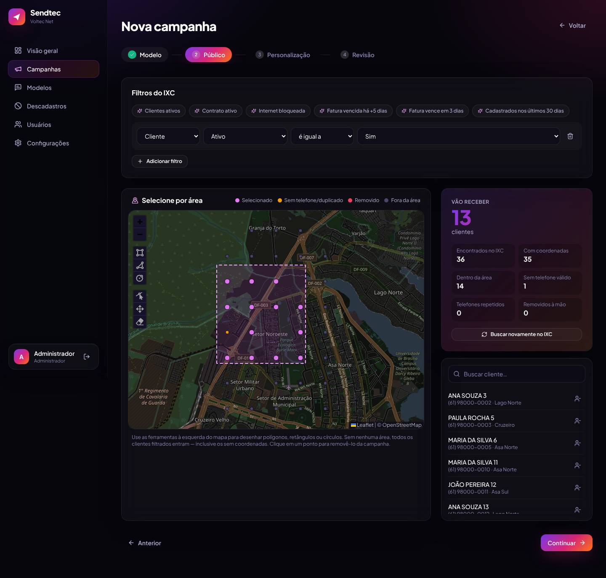
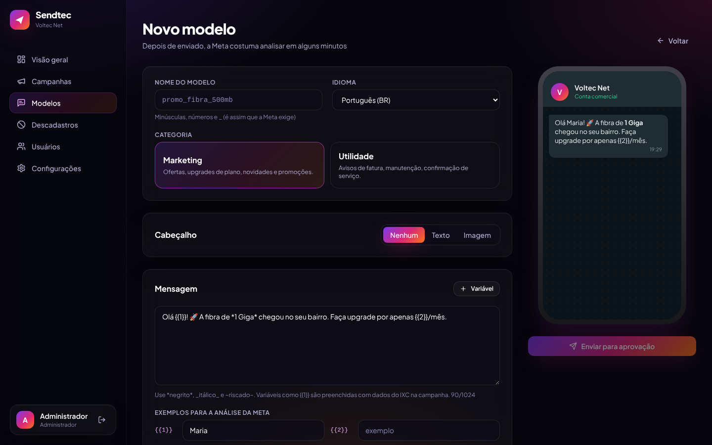
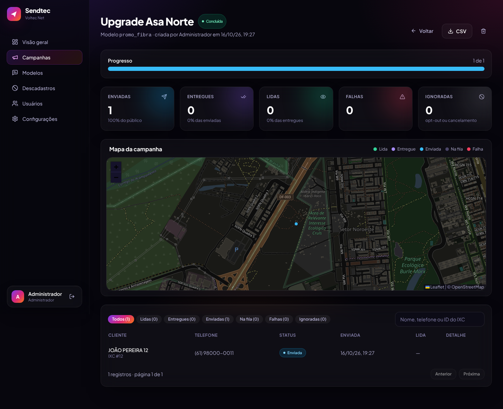

# Sendtec

Disparo de modelos do WhatsApp (API oficial da Meta) para clientes do **IXC Provedor**, com seleção de público por filtros do IXC e por **área desenhada no mapa**. As mensagens saem pelo **Chatwoot**, ficando registradas na conversa de cada cliente.



## O que ele faz

- **Público a partir do IXC**: filtros sobre qualquer campo de `cliente`, `cliente_contrato` e `fn_areceber` (atalhos prontos como "Clientes ativos", "Internet bloqueada" e "Fatura vencida há +5 dias"). As datas podem ser relativas, como `@hoje-5`.
- **Seleção no mapa**: polígonos, retângulos e círculos sobre as coordenadas do cadastro. Também dá para clicar num cliente e removê-lo da campanha.
- **Modelos da Meta**: criação de modelos de marketing e de utilidade com imagem, texto, rodapé e botões. A tela mostra uma prévia estilo WhatsApp, e o sistema acompanha a aprovação automaticamente.
- **Variáveis preenchidas pelo IXC**: primeiro nome, plano, valor e vencimento da fatura, linha digitável, ou um texto fixo.
- **Disparo via Chatwoot**: cada cliente ganha uma conversa nova com a etiqueta da campanha. A velocidade é configurável, e dá para pausar, retomar, cancelar e reenviar as falhas.
- **Agendamento** com data e hora.
- **Relatórios**: enviadas, entregues, lidas e falhas por campanha, com mapa colorido por status e exportação em CSV.
- **Descadastro (opt-out)**: quem responde "SAIR" (ou toca no botão "Sair") deixa de receber campanhas de marketing.
- **Perfis de acesso**: Administrador (integrações e usuários) e Operador (modelos e campanhas).

| Criação de modelo | Relatório da campanha |
|---|---|
|  |  |

## Instalação (Docker)

Requisitos: um servidor com Docker e Docker Compose, na mesma rede do IXC e do Chatwoot.

```bash
git clone <repo> sendtec && cd sendtec
cp .env.example .env
# edite .env: APP_SECRET (openssl rand -hex 32), senhas e e-mail do admin
docker compose up -d --build
```

Acesse `http://IP-DO-SERVIDOR:3000` e entre com o `ADMIN_EMAIL` e o `ADMIN_PASSWORD` do `.env`. Depois do primeiro acesso, troque a senha em **Usuários**.

> **URL pública (necessária para modelos com imagem):** no envio, a Meta baixa a imagem do cabeçalho direto do Sendtec. Publique o Sendtec em HTTPS (proxy reverso como Nginx/Caddy, ou um túnel da Cloudflare) e informe essa URL em **Configurações → Geral**. Basta liberar o caminho `/api/media/` para a internet; o resto pode ficar só na rede interna.

## Configuração (Configurações, como administrador)

Cada bloco tem um botão **Testar conexão**.

### IXC
1. No IXC, crie ou use um usuário com acesso de leitura às tabelas de clientes, contratos e financeiro, e gere o **token da API**.
2. Informe a URL do IXC e o token no formato `id:token`.
3. Em **Campos de telefone**, defina a ordem de preferência (padrão: `whatsapp, telefone_celular, fone`). Os números são normalizados para `+55DDNNNNNNNNN`.

### Chatwoot (4.x)
1. Gere um token de acesso (Perfil → Token de acesso) de um administrador.
2. Informe a URL, o ID da conta e o ID da caixa de entrada do **WhatsApp Cloud**. O teste de conexão lista as caixas disponíveis.
3. Em **Configurações → Integrações → Webhooks** do Chatwoot, cadastre a URL exibida no Sendtec e marque **Mensagem criada** e **Mensagem atualizada**. É por esse webhook que chegam entregas, leituras, falhas e descadastros.
4. Se o seu Chatwoot for anterior à 4.4 e os modelos chegarem sem as variáveis, ative **Formato antigo de parâmetros**.

### Meta
Os modelos são criados direto na Graph API, porque o Chatwoot só sincroniza modelos, não os cria.
1. No Gerenciador de Negócios: **Usuários do sistema** → crie um usuário administrador → atribua o app e a conta do WhatsApp → **Gerar token** (sem expiração) com as permissões `whatsapp_business_management` e `whatsapp_business_messaging`.
2. Informe o **WABA ID** (Gerenciador do WhatsApp → Configurações da conta), o **App ID** (necessário para enviar imagens de modelo) e o token.
3. Depois de configurar, use **Modelos → Sincronizar** para trazer os modelos que já existem. A partir daí, os novos modelos são acompanhados sozinhos até a aprovação.

## Como uma campanha funciona

1. **Modelo**: escolha um modelo aprovado.
2. **Público**: combine filtros do IXC e desenhe áreas no mapa. O contador mostra em tempo real quantos clientes vão receber, além dos que ficaram fora por falta de telefone, por telefone duplicado ou por estarem fora da área.
3. **Personalização**: ligue cada `{{n}}` a um dado do IXC (com formato: nome próprio, data, moeda) ou a um texto fixo.
4. **Revisão**: dispare agora ou agende.

No momento do disparo, o público é buscado de novo no IXC, para sair com os dados atualizados. Campanhas de marketing nunca vão para quem está na lista de descadastro. Se o servidor reiniciar no meio de um envio, a campanha continua de onde parou. O envio que estava em andamento nessa hora fica marcado como falha, para conferência no Chatwoot.

## Desenvolvimento

```bash
npm install
# Postgres local e um .env em apps/api (DATABASE_URL, APP_SECRET)
npm run prisma:migrate -w apps/api
npm run dev:api      # http://localhost:3000/api
npm run dev:web      # http://localhost:5173 (proxy para a API)
npm test -w apps/api # testes unitários
```

Estrutura:

```
apps/api   NestJS + Prisma (PostgreSQL). Integrações: src/ixc, src/chatwoot, src/meta
apps/web   React + Vite + Tailwind + Leaflet (servido pela API em produção)
```
